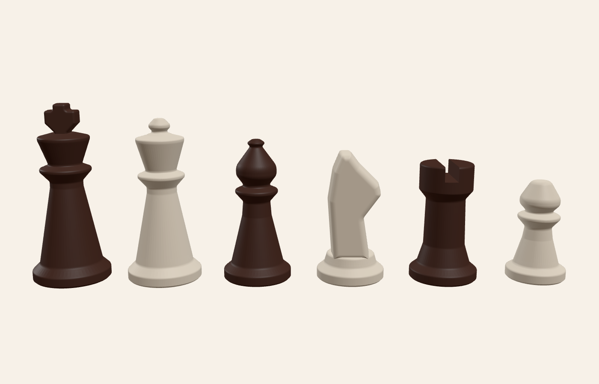

# Max' Schach Schokolade

Ein vollständiges Schachspiel aus Schokolade: 16 Figuren aus dunkler und 16 Figuren aus weisser Schokolade, als ganze, freistehende Figuren gegossen. Formen und Box entstehen auf einem Bambu Lab P2S. Die Box zeigt auf dem Deckel das Schachbrett.



## Stand

CAD fertig, Druckaufträge in [druck/](druck/README.md). Als Nächstes: Probeform drucken und den ersten Bauern und Springer giessen.

## Dokumente

| Dokument | Inhalt |
|---|---|
| [docs/01-recherche.md](docs/01-recherche.md) | Was andere gemacht haben, was funktioniert und was nicht, lebensmittelechtes Filament, Entformen |
| [docs/02-plan-giessform.md](docs/02-plan-giessform.md) | Plan für die Giessform: Aufbau, Anguss, Entlüftung, Fixierung, Kühlen, Entformen, Phasen |
| [docs/03-figuren.md](docs/03-figuren.md) | Figurenset: Masse, Gestaltungsregeln, Gewicht |
| [docs/04-ablauf-giessen.md](docs/04-ablauf-giessen.md) | Ablauf eines Gusstags für dunkle und weisse Schokolade |
| [docs/05-cad-und-druck.md](docs/05-cad-und-druck.md) | CAD, Prüfungen, Druckeinstellungen für den P2S, Filament |
| [docs/06-box.md](docs/06-box.md) | Box aus dem 3D-Drucker: Unterteil, Einlage, Deckel mit Schachbrett |
| [docs/ideen.md](docs/ideen.md) | Ideen und offene Fragen |

## Kurzfassung des Plans

1. Die Giessform wird direkt auf dem P2S gedruckt, aus lebensmittelechtem PLA Pure mit der gehärteten Stahldüse. Kein Silikon.
2. Alle 16 Figuren einer Farbe in einem Guss: Buchform aus 5 Platten mit 4 Reihen zu 4 Figuren.
3. Gegen Rillen: Formplatten stehend mit 0.08 mm gedruckt, Kavitäten nass geschliffen bis Körnung 3000.
4. Die Figuren haben keine Hinterschnitte, damit sich die starren Platten senkrecht abziehen lassen.
5. Gegossen wird kopfüber durch den Standfuss, der Fuss ist der Einguss. Entlüftung über 45°-Schrägen.
6. Gedruckte Kegelnoppen und 4 Gewindestangen mit Flügelmuttern verhindern jedes Verrutschen.
7. Waschen von Hand mit warmem Wasser bis 45 °C, Kakaobutter schmilzt bei etwa 34 °C.

## Repository-Struktur

```
cad/        parametrische Modelle (CadQuery, Python)
druck/      Druckaufträge als 3MF, eine Datei pro Druckplatte
stl/        Einzelteile als STL, in Drucklage
bilder/     Ansichten aus dem CAD, Übersicht in bilder/README.md
docs/       Pläne, Recherche, Ablauf
```
