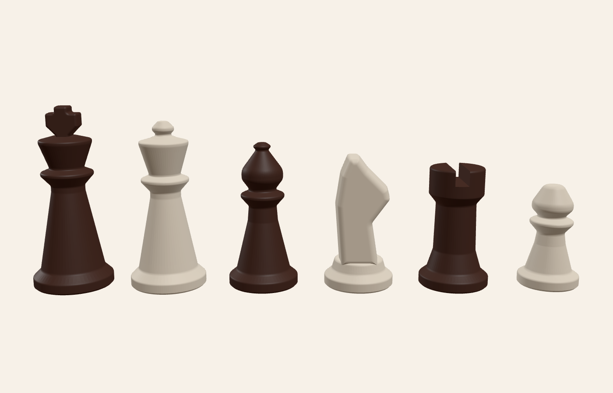
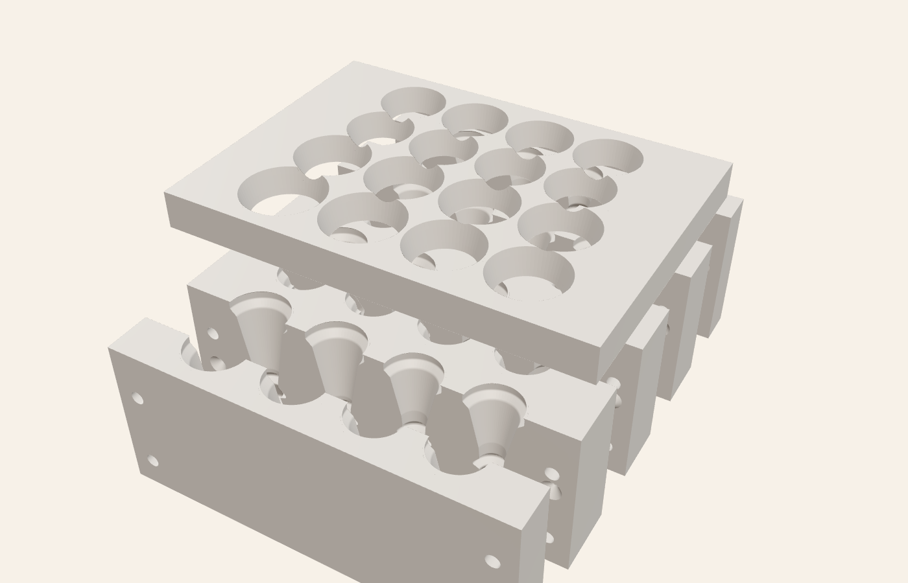

# CAD und Druck auf dem Bambu Lab P2S

Alle Teile sind parametrisch in Python mit CadQuery gebaut. Masse ändern, neu erzeugen, fertig.

## Erzeugen

```
pip install -r cad/requirements.txt
python3 cad/test_cad.py     # Prüfungen
python3 cad/bauen.py        # STL in Drucklage nach stl/, Masse nach stl/masse.json
python3 cad/druckplatte.py  # Druckaufträge als 3MF nach druck/
python3 cad/ansicht.py      # Bilder nach bilder/, braucht Chrome mit CDP auf Port 29229
```

| Datei | Inhalt |
|---|---|
| `cad/figuren.py` | 6 Figuren, Masse in `SET` |
| `cad/profil.py` | Gerundete Profile und Drehkörper |
| `cad/form.py` | Buchform `VOLLSATZ` (16 Figuren) und Probeform `PROBE` (Bauer, Springer), Masse in `Massen` |
| `cad/box.py` | Box, Masse in `BoxMasse` |
| `cad/pruefen.py` | Hinterschnitte, zu flache Unterseiten, Luftfallen |
| `cad/bauen.py`, `cad/ansicht.py` | Export und Bilder |

## Figuren



Prüfung in Giesslage (kopfüber, Trennebene y = 0, Entformen in ±Y):

| Figur | Höhe | Fuss Ø | Volumen | Hinterschnitt | Zu flach (unter 45°) | Luftfallen |
|---|---:|---:|---:|---:|---:|---:|
| König | 60 mm | 26 mm | 11.4 cm³ | 0 | 0 | 0 |
| Dame | 55 mm | 25 mm | 9.7 cm³ | 0 | 0 | 0 |
| Läufer | 48 mm | 23 mm | 7.0 cm³ | 0 | 0 | 0 |
| Springer | 44 mm | 23 mm | 8.6 cm³ | 0.02 mm² | 0.55 mm² | 0 |
| Turm | 40 mm | 23 mm | 8.2 cm³ | 0 | 0 | 0 |
| Bauer | 34 mm | 20 mm | 4.4 cm³ | 0 | 0 | 0 |

Die Restflächen beim Springer sind Facetten der Rundungen, kleiner als eine Düsenbreite. König, Springer und die Platten mit ihren Kavitäten haben im STL einzelne offene Kanten unter 0.1 mm an den Rundungen von Kreuz und Kopf. Bambu Studio repariert sie beim Laden (Meldung bestätigen). Ein Satz einer Farbe hat 104 cm³, etwa 135 g Schokolade ohne Überlauf.

## Formen



| Form | Aussenmass B × T × H | Platten | Dicke der Platten |
|---|---|---:|---|
| Probeform (Bauer, Springer) | 91 × 35 × 48 mm | 2 | 17.5, 17.5 mm |
| Buchform (16 Figuren) | 161 × 113 × 64 mm | 5 | 19, 28.5, 25.5, 24, 16 mm |

Die Trichterplatte ist 4 × 2.7 mm grösser und sitzt mit einer Schürze auf dem Stapel. Alle Teile passen einzeln in den Bauraum des P2S (256 × 256 × 256 mm). Die 5 Platten der Buchform passen zusammen auf eine Platte.

## Druckeinstellungen P2S (Bambu Studio)

Düse: Serie, gehärteter Stahl 0.4 mm. Vor dem ersten Druck mit PLA Pure die Düse mit PLA Pure spülen (etwa 50 g), damit keine Reste anderer Filamente in die Formen kommen. Druckplatte: Textured PEI, Platte vorher mit Spülmittel waschen.

| Teil | Filament | Lage | Schicht | Wände | Füllung | Stützen | Sonst |
|---|---|---|---|---|---|---|---|
| Formplatten | PLA Pure White | wie STL: stehend, Giessebene oben | 0.08 mm | 5 | 15 % Gyroid | keine | Naht: Ausrichtung Rückseite, Aussenwand zuerst aus, Aussenwand 60 mm/s, Brim 5 mm |
| Trichterplatte | PLA Pure White | wie STL: Oberseite auf dem Bett | 0.12 mm | 4 | 15 % | keine | |
| Box-Unterteil | PLA Pure Apricot, Schrift Black | wie STL: Boden auf dem Bett | 0.2 mm | 3 | 15 % | keine | Unterteil und Beschriftung als ein Objekt mit 2 Teilen laden |
| Box-Einlage | PLA Pure White | wie STL: Oberseite auf dem Bett | 0.2 mm | 3 | 15 % | keine | |
| Box-Deckel | PLA Pure White, Felder Black | wie STL: Schachbrett auf dem Bett | 0.2 mm | 3 | 15 % | keine | Deckel und Felder als ein Objekt mit 2 Teilen laden |

Zweifarbig (Deckelfelder, Beschriftung) druckt das AMS des P2S.

Nach dem Druck:
1. Bohrungen Ø 5.4 für die Gewindestangen mit 5 mm durchbohren.
2. Trennflächen planschleifen, Kavitäten nass schleifen bis 3000 (docs/02-plan-giessform.md, Abschnitt 3). Die ungeraden Platten mit den Kegelnoppen auf dem schmalen Schleifstreifen.
3. Platten trocken zusammenstecken. Klemmt eine Noppe, die Aufnahme mit Schleifpapier 400 leicht nacharbeiten, nicht die Noppe.
4. Waschen, trocknen.

## Filament

| Teil | Farbe | Menge |
|---|---|---:|
| Buchform mit Trichterplatte | White | etwa 0.7 kg |
| Probeform | White | etwa 0.15 kg |
| Box-Einlage und Deckel | White | etwa 0.4 kg |
| Box-Unterteil | Apricot | etwa 0.35 kg |
| Schachfelder, Schrift | Black | unter 0.05 kg |

Bestellung: 2 × White, 1 × Apricot, 1 × Black, je 1 kg PLA Pure.
