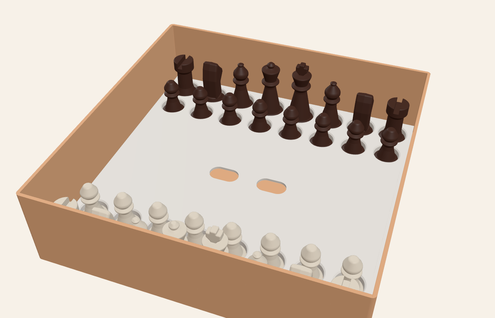
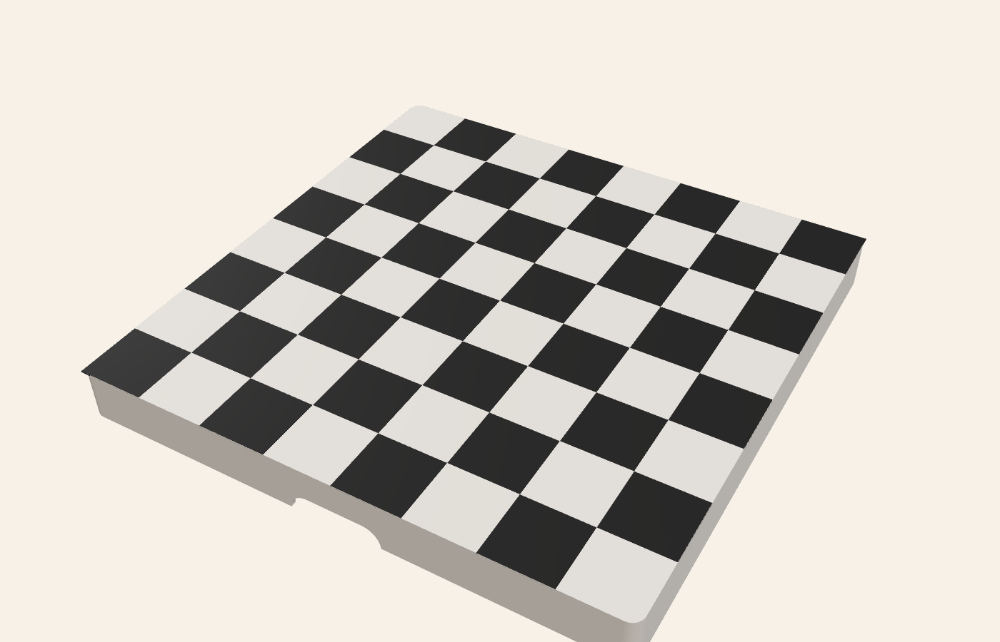
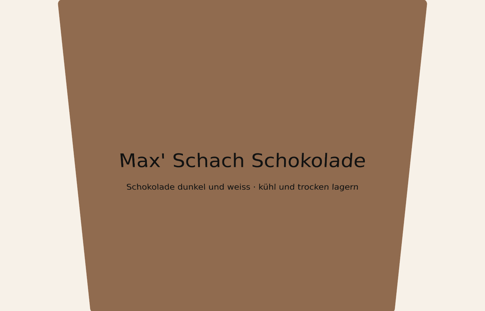
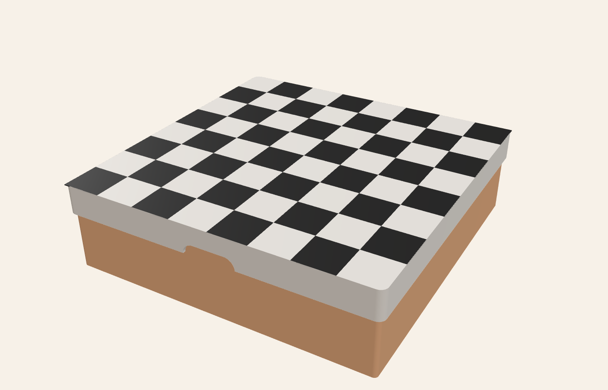

# Box aus dem 3D-Drucker

Wiederverwendbare Box für alle 32 Figuren, ganz aus PLA Pure, ohne Kleben. Alternative zum Kartonentwurf in verpackung/. CAD: `cad/box.py`, Druck: docs/05-cad-und-druck.md.

## Aufbau

| Teil | Mass | Funktion |
|---|---|---|
| Deckel | 240 × 240 × 22.4 mm | Stülpdeckel, oben Schachbrett 8 × 8 Felder à 30 mm, dunkle Felder bündig eingelegt. Zwei Griffmulden in der Schürze. |
| Unterteil | 234.6 × 234.6 × 65 mm, Wand 2.4 mm, Boden 2 mm | Innen 229.8 mm. Unten die Beschriftung, 0.6 mm tief, in Black gefüllt. |
| Einlage | 228.8 × 228.8 × 8 mm | Erhöht, 32 Löcher in Grundstellung, Raster 28 mm, in zwei massiven Bändern. Zwei Grifflöcher in der Mitte zum Herausnehmen. |

Höhe geschlossen: 67.4 mm. Innenhöhe vom Boden bis unter den Deckel: 63 mm, also 3 mm Luft über dem König (60 mm).

## Einlage

- Die Figuren stehen auf dem Boden des Unterteils. Die Löcher der Einlage fassen den ganzen Fuss, 8 mm hoch.
- Loch Ø = Fuss Ø + 0.8 mm: König 26.8, Dame 25.8, Läufer, Springer und Turm 23.8, Bauer 20.8 mm. Oben 1 mm Fase.
- Weiss in den Reihen 1 und 2, dunkel in den Reihen 7 und 8, wie auf dem Brett. Die Mitte bleibt frei, z. B. für eine Karte.
- Werden die Figuren nach dem ersten Guss gemessen, `loch_spiel` und die Fussmasse in `cad/figuren.py` anpassen und neu erzeugen.

## Deckel und Beschriftung

- Feld links unten (a1) ist dunkel, wie beim Schach.
- Text unten: «Max' Schach Schokolade», darunter «Schokolade dunkel und weiss · kühl und trocken lagern». Text in `BoxMasse.text` und `BoxMasse.text_unten`.
- Der Deckel sitzt mit 0.3 mm Spiel. Ist er zu fest oder zu locker, `spiel` anpassen.

## Wiederverwenden und Lebensmittel

- Alles aus PLA Pure. Die Einlage berührt die Figuren und ist deshalb lebensmittelecht.
- Feucht abwischen oder von Hand waschen bis 45 °C, nicht in die Spülmaschine.
- Lagern bei 12 bis 18 °C, trocken, ohne direkte Sonne. Über 25 °C werden die Figuren weich.
- Für den Versand die Figuren einzeln in Folie, und die Box aufrecht halten.

