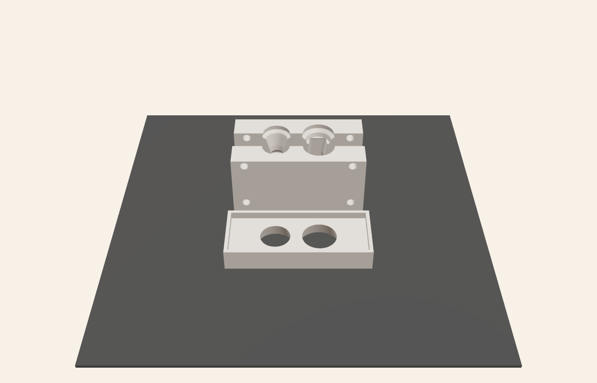
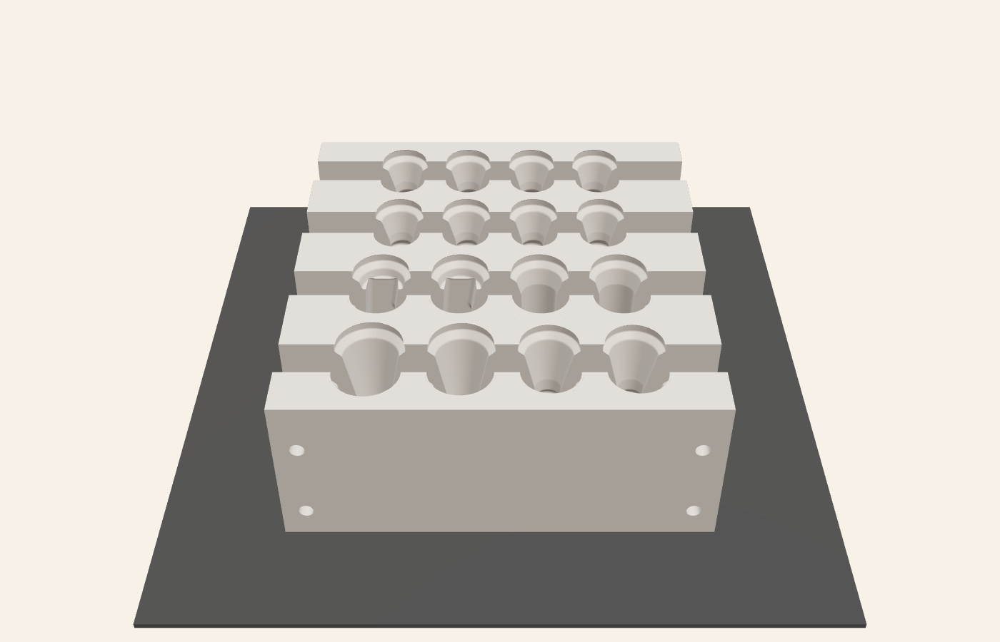

# Druckaufträge für den P2S

Jede Datei ist eine Druckplatte. In Bambu Studio öffnen, Profil nach der Tabelle einstellen, an den Drucker senden. Druckeinstellungen im Detail: [docs/05-cad-und-druck.md](../docs/05-cad-und-druck.md). Erzeugt mit `python3 cad/bauen.py` und `python3 cad/druckplatte.py`. Die Box-Dateien 4 und 6 enthalten je ein Objekt aus zwei Teilen für das AMS.

| Nr | Datei | Teile | Filament | Schicht | Beim Öffnen |
|---|---|---|---|---|---|
| 1 | [01_probeform.3mf](01_probeform.3mf) | Probeform Bauer und Springer: 2 Platten und Trichter | White | 0.08 mm | Einzelne Objekte (Nein) |
| 2 | [02_vollsatz_formplatten.3mf](02_vollsatz_formplatten.3mf) | Buchform: 5 Platten | White | 0.08 mm | Einzelne Objekte (Nein) |
| 3 | [03_vollsatz_trichter.3mf](03_vollsatz_trichter.3mf) | Buchform: Trichterplatte | White | 0.12 mm | |
| 4 | [04_box_unterteil.3mf](04_box_unterteil.3mf) | Box-Unterteil mit Schrift unten | Apricot, Schrift Black | 0.2 mm | Teil Beschriftung auf Black stellen |
| 5 | [05_box_einlage.3mf](05_box_einlage.3mf) | Erhöhte Einlage | White | 0.2 mm | |
| 6 | [06_box_deckel.3mf](06_box_deckel.3mf) | Deckel mit Schachbrett | White, Felder Black | 0.2 mm | Teil Felder auf Black stellen |

Alle Druckplatten als Bild: [bilder/README.md](../bilder/README.md#druckplatten).

Reihenfolge: Erst Nr 1 drucken, schleifen und giessen. Nr 2 und 3 erst, wenn die Probeform keine Rillen zeigt.

Meldet Bambu Studio offene Kanten an Formplatten, die Reparatur bestätigen. Es sind Rundungen unter 0.1 mm.
