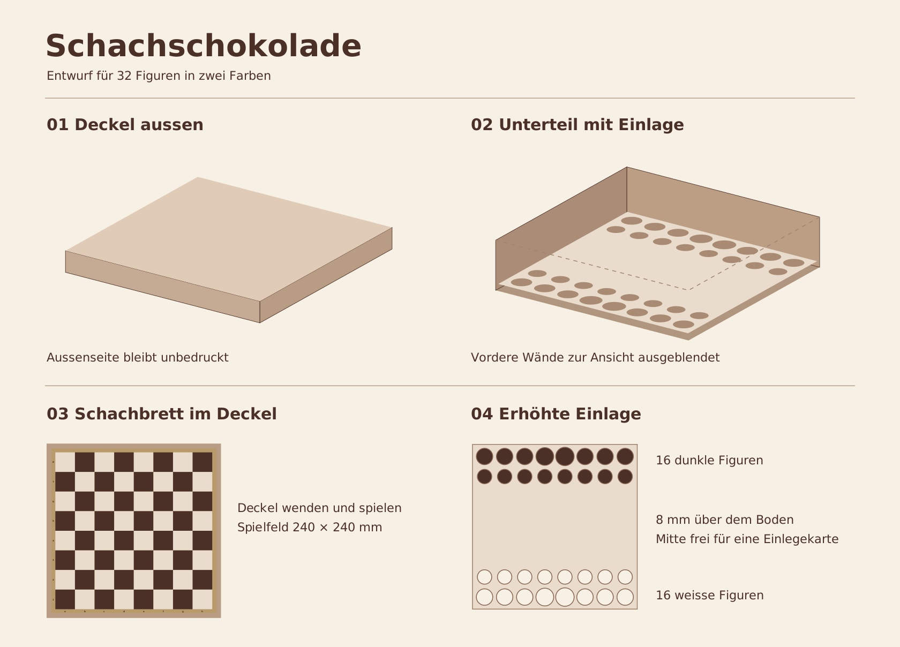

# Verpackung für die Schachschokolade

Kartonentwurf mit Falzmuster. Die 3D-gedruckte Box ist in docs/06-box.md und cad/box.py beschrieben.

Prototyp für 32 massive Figuren, je 16 aus dunkler und weisser Schokolade. Nutzlast rund 260 g. Die vorläufigen Figurenmasse stammen aus [dem Figurenplan in PR #1](https://github.com/BitSparkCode/schach-schokolade/blob/devin/1795270432-plan-giessform/docs/03-figuren.md). Vor der Kleinserie am ersten Guss und am gewählten Karton nachmessen.



## Aufbau

| Teil | Nennmasse ab Rillachse | Aufbau |
|---|---:|---|
| Unterteil | 250 × 250 × 65 mm | Vier aufgestellte Wände mit innen verklebten Ecklaschen. Die Höhe ergibt sich aus 60 mm für den König plus 5 mm Kopfspiel. |
| Stülpdeckel | 252 × 252 × 28 mm | Abnehmbar, seitlich 1 mm Spiel pro Seite ab Rillachse. Die Aussenseite bleibt vorerst unbedruckt. Zum Spielen Deckel abheben und wenden, damit die Innenseite mit dem Brett oben liegt. |
| Einlage | 246 × 246 × 8 mm | Vier nach unten gefalzte Stützwände, mit Ecklaschen verklebt. Die Platte sitzt 8 mm über dem Boden und hat nominell 2 mm Abstand pro Seite ab Rillachse. |
| Schachbrett | 240 × 240 mm | 8 × 8 Felder zu 30 mm in Kakaobraun und Creme. 6 mm Rand in mattem Ocker bis zur Deckelrille, mit a bis h unten und 1 bis 8 links. Links unten ist a1 dunkel, rechts unten h1 hell. |

Vier Reihen zu acht Plätzen nutzen den Platz an zwei gegenüberliegenden Seiten. Aussen liegen die Grundreihen, innen die Bauern. So lassen sich die Farben getrennt einpacken und die Figuren abzählen. Die Mitte bleibt frei, zum Beispiel für eine flache Anleitung mit der Schachaufstellung. Am engsten Punkt zwischen den Löchern für König und Dame bleiben 3 mm Kartonsteg.

Die einzeln umhüllten Figuren werden mit dem Fuss voran von oben durch die Öffnungen gesteckt. Der Fuss trägt auf dem Schachtelboden; das Loch führt die Figur auf Höhe der Einlage. Die Lochdurchmesser rechnen mit 1,5 mm diametraler Zugabe zum Fuss. Hüllen ohne dicke Nähte oder Falten am Fuss wählen. Die Zeichnung enthält noch keinen Niederhalter: aufrecht lagern und übergeben. Für Versand und Kippen eine zweite Sicherung erproben, die nicht auf Kreuz, Spitze oder Pferdekopf drückt. Bei Bedarf die Mitte der Einlage mit einer lose eingelegten Kartonstütze unterbauen.

## Material, Lebensmittelkontakt und Druck

- Prototyp: glatter Faltschachtelkarton aus Frischfasern, etwa 400 bis 500 g/m² für Unterteil und Deckel; für die Einlage als Startbereich 350 bis 450 g/m². Die tatsächliche Dicke, Steifigkeit und der Faserlauf zählen für die Passung. Eine weiche Rille oder eine angepasste Rillnut verhindert Bruch beim Falzen.
- Für befüllte Schachteln: jede Figur mit einer dafür ausgewiesenen, fettbeständigen Lebensmittelhülle schützen, etwa geeignetem Pergamin oder einer geeigneten Folie. Beim Lieferanten die Eignung für fetthaltige Schokolade, die vorgesehene Lagerdauer und Temperatur schriftlich bestätigen lassen. Falls ein ungeschützter Kontakt vorgesehen ist, vorab auch Karton, Schnittkanten und allfällige Einlagen nach Schweizer Vorgaben für den vorgesehenen Kontakt beurteilen lassen. Frischfaser allein ist kein Nachweis.
- Brettdruck nur auf der Deckelinnenseite, ohne Veredelung. Bis die bedruckte Oberfläche für direkten Kontakt mit Schokolade geprüft und freigegeben ist, Figuren auch beim Spielen in ihren Hüllen lassen. Für die Serie geeignete, migrationsarme Farben und Klebstoffe mit der Druckerei abstimmen; auch Abklatsch im Druckbogenstapel und Geruch am fertigen Muster prüfen. Keine frei liegenden Klebstoffreste. Zutaten, Allergene und weitere Pflichtangaben bei Abgabe oder Verkauf separat klären.
- Für den Prototyp den Brettdruck bei 100 % ausgeben, mittig auf die gemessene lichte Deckelfläche zuschneiden und innen kaschieren. Feldgrösse nicht skalieren; prüfen, ob der Zuschnitt alle Koordinaten stehen lässt. Beim Direktdruck das Motiv auf der Innenseite des Stanzbogens an den Rillachsen ausrichten. Das Motiv zeigt die spätere Draufsicht auf die Innenseite und wird nicht gespiegelt. Das PDF ist eine RGB-Vektordatei mit TrimBox und 3 mm Anschnitt rundum, kein PDF/X. Für die Auflage Farbprofil und Format vereinbaren und einen Farbabzug freigeben.
- Die Deckelaussenseite bleibt im Kartonton, bis Maximilian seine Idee für den individuellen Druck vorlegt. Dafür gibt es noch keine Druckdatei.

## Dateien und Herstellung

| Datei | Verwendung |
|---|---|
| [Falzmuster als PDF](vorlagen/falzmuster.pdf) | Drei Seiten in Originalgrösse: Unterteil, Deckel und Einlage. |
| [Unterteil](vorlagen/unterteil.svg), [Deckel](vorlagen/deckel.svg), [Einlage](vorlagen/einlage.svg) | SVG in 1:1 mit Bemassung. Rot durchgezogen: Schnitt. Blau gestrichelt: Talfalz, blau strichpunktiert: Bergfalz. Grün gepunktet: Klebefläche. |
| [Brettdruck innen als PDF](vorlagen/brettdruck.pdf), [SVG](vorlagen/brettdruck.svg) | Nennformat bis zur Rillachse 252 × 252 mm, mit Anschnitt 258 × 258 mm. |
| [Vorschau als PNG](vorlagen/vorschau.png) | Unbedruckter Deckel aussen, Brett innen, Unterteil und Einlage. Nicht massstäblich drucken. |

1. Bei 100 % drucken, ohne Seitenanpassung. Die 50-mm-Kontrollstrecke auf jedem Falzmuster messen. Die PDF-Seiten messen in der Reihenfolge 414 × 451 mm, 342 × 379 mm und 296 × 353 mm. Unterteil und Deckel auf A2 drucken, sofern der bedruckbare Bereich reicht, sonst auf breiterem Papier oder gekachelt bei 100 %. Die Einlage passt nur bei genügend Druckbreite auf A3. Die Zuschnitte ohne Bemassung messen 380 × 380 mm, 308 × 308 mm und 262 × 262 mm.
2. Für das Einzelmuster mit Rillwerkzeug, Messer und Lochschneider arbeiten oder auf einem Flachbettplotter schneiden und rillen. Im Plotter nur rote Konturen als Schnitt und blaue Linien als Rillung zuweisen, nicht die Bemassung oder Klebemarkierungen. Die blauen Pfade durchgehend rillen, auch wenn sie in der Zeichnung gestrichelt sind.
3. Unterteil und Deckel mit den Wänden nach oben falten, die Einlagenwände nach unten. Je vier Laschen innen an den angrenzenden Wänden befestigen. Klebstoff auf die jeweilige Kontaktseite der markierten Laschenfläche auftragen. Den Deckel zum Schliessen wenden.
4. Einen unbedruckten Satz aufbauen. Deckelsitz, falzbedingten Platzbedarf und Einlage prüfen, dann 32 umhüllte Figuren einsetzen. Die Figuren sollen ohne Kraft passen und beim Herausnehmen nicht am Karton hängen. Schachtel mit geschlossenem Deckel handhaben und die Figuren auf Abrieb, Druckstellen und Bruch kontrollieren. Erst danach Kartonsorte, Rillen, Lochzugabe, Farben und Werkzeug festlegen. Für kleine Mengen ist ein Schneidplotter sinnvoll; für höhere Stückzahlen Angebote für Stanzen und Drucken einholen.

## Masse ändern

`FIGUREN`, `FELD` und die Masse für Spiele, Wände und Anschnitt stehen am Anfang von [generieren.py](generieren.py). Die Ausgangswerte sind König 60/26, Dame 55/25, Läufer 48/23, Springer 44/23, Turm 40/23 und Bauer 34/20 mm (Höhe/Fussdurchmesser). Die Prüfungen im Skript melden zu schmale Stege. Eine Änderung der Kartondicke muss am Muster geprüft werden; die Masse sind Rillachsenmasse und keine zugesicherten Innenmasse.

Im Hauptverzeichnis des Repos mit Python 3.10 oder neuer:

```sh
python3 -m venv ~/.venv-schach-verpackung
~/.venv-schach-verpackung/bin/python -m pip install -r verpackung/requirements.txt
~/.venv-schach-verpackung/bin/python verpackung/generieren.py
~/.venv-schach-verpackung/bin/python -m unittest discover -s verpackung
```

CairoSVG benötigt Cairo auf dem System; für vergleichbare Schriften DejaVu Sans installieren. Die erzeugten Dateien landen in `verpackung/vorlagen/`. Wenn sich Nennmasse ändern, auch die Massangaben im Plan abgleichen.

## Offene Fragen

1. Welche Masse haben die gegossenen Figuren samt Hülle, insbesondere am Fuss und 8 mm über dem Boden? Lassen sich alle Figuren ohne Druck einsetzen und entnehmen?
2. Reicht eine aufrechte Übergabe oder braucht es eine Versandsicherung? Braucht die Einlage bei der gewählten Kartonstärke eine Stütze in der Mitte?
3. Wie viele Sets werden benötigt und wer übernimmt Plotten oder Stanzen sowie die Druckfreigabe?
4. Welche geeignete Einzelhülle und welcher Karton sind erhältlich? Soll das Brett separat aufkaschiert oder direkt gedruckt werden?
5. Welches Motiv möchte Maximilian später auf die Deckelaussenseite drucken?
